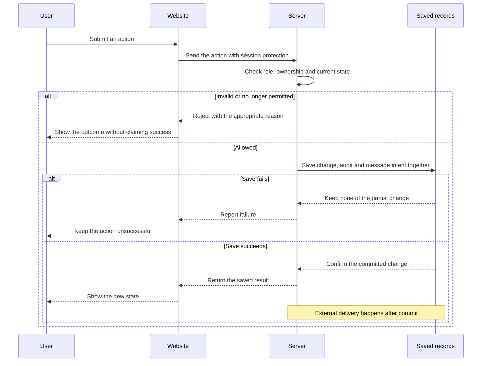

# How InTuition is built

InTuition is a tuition marketplace being developed for Singapore. It is **not live**. Launch has been delayed by life commitments. This page describes the implementation available for inspection, with release plans identified separately.

The application source remains private. This public collection explains the product, its decisions and its engineering approach without publishing application code, credentials or operating details. Start with the [current requirements](../specs/CURRENT-REQUIREMENTS.md) for the intended product behaviour.

The [current-file alignment review](current-file-alignment.md) records confirmed differences between those requirements and the application. In particular, contact-change delivery and revocation, first-session billing stages, and some interview behaviour remain incomplete. The mechanisms below should not be read as proof that every feature using them works.

## The main parts

| Part | What it does | Technology found in the implementation |
|---|---|---|
| Browser application | Shows listings, forms, dashboards and administration screens. | React 19.2.6, TypeScript 6.0.3 and Vite 8.0.14; Tailwind CSS 3.4.19 for styling. |
| Server application | Checks permissions, applies marketplace rules and exposes the API that the browser calls. | Java 21 and Spring Boot 3.3.0, with Spring Security and Spring Data JPA. |
| Main database | Stores accounts, requests, applications, matches and other durable records. | PostgreSQL; the inspected development and combined-test definitions use version 15. Liquibase manages schema changes. |
| Supporting store | Supports session checks, request limits and queued messages. | Redis 7 in the inspected development and combined-test definitions. |
| Scheduled work | Runs time-based tasks such as interview reminders. | db-scheduler 16.12.0, with jobs recorded in the database. |

The browser uses TanStack Query for server data, React Hook Form and Zod for forms, and React Router for navigation. These are supporting choices; business rules still need server checks because a browser cannot be trusted to enforce permissions.

Versions above come from the private dependency lockfiles and build definitions inspected on 18 October 2026. They describe that snapshot, not a claim that every dependency is current or that the application was rebuilt for this publication. Some older design documents name earlier versions.

## Following one request

A tutee fills in a tuition request in the browser. The server checks the request and the caller's permissions before storing it. Administration, applications, selection and assignment then move the request through defined states. The database remains the record of those changes; a successful-looking screen alone is insufficient proof that they happened.

### Browser, server and saved result

**Required request boundary, 18 October 2026.** The layers exist in the inspected application; this diagram describes the required ordering, not a fresh passing run. It applies to a change that requires a notification under [C12](../specs/CURRENT-REQUIREMENTS.md). A simpler change need not create a message.

“Message intent” includes the required in-app notification and the saved request for external delivery. Either these and the business change commit together, or none do. A valid session alone does not authorize an action. The server checks ownership, state and request-forgery protection; conflicting changes must not create duplicate results. Contact fields are stored as readable text under C13, while disclosure remains restricted under C04. Passwords follow their separate hashing rules.

The [notification sequence](sequence-diagrams.md#notifications-and-delivery-recovery) begins from the committed records and shows pending, retry and permanent-failure outcomes. Saving a request does not prove an email arrived. **G08/G09 remain open:** current delivery and reminder paths do not yet meet all those requirements. See [protected writes](../specs/sequences/25-csrf-protected-write.md), [contact storage](../specs/sequences/27-encrypted-pii-write-and-lookup.md), [transactional messaging](../specs/sequences/26-email-fanout-on-event.md) and the [current-file review](current-file-alignment.md).

Contact details are protected separately from public listing information. Public browsing uses restricted response shapes. Assigned participants have a specific, authorised contact-reveal path. This distinction matters: the product does not promise to hide contact details from the people who have been matched. The [current requirements](../specs/CURRENT-REQUIREMENTS.md) take precedence over older wording that suggests otherwise.

The frontend, backend, browser tests and specifications are maintained in separate repositories. Combined checks bring the parts together so a change in one repository can be tested against its consumers. [Testing and release](testing-and-release.md) describes the boundaries and remaining gaps.

## Security and stability mechanisms

The inspected implementation contains the following mechanisms. Their presence is evidence of engineering work, not a security certification or a guarantee that every path is correct.

| Concern | Mechanism present |
|---|---|
| Account access | Password hashing with BCrypt, role checks on protected server routes, request-forgery protection, and checks on signed access tokens. |
| Session expiry and reuse | Short-lived access sessions and rotating refresh credentials for eligible users, with server-side revocation and reuse detection. See [session hardening](../specs/004-auth-session-hardening-30min-ttl-and-refresh/spec.md). |
| Stored contact information | The current account model stores email and phone in plain text, following an explicit change from the earlier encryption proposal. Access restrictions and access records still apply. The presence of an encryption component elsewhere does not mean these contact fields use it. |
| Repeated or conflicting actions | Database constraints, version checks on selected records, and replay protection for supported operations. Replay protection lets a repeated request return its earlier result instead of performing the action twice. |
| Notification delivery | A database outbox records work alongside a business change; workers then pass messages to delivery queues. Retry handling and a separate queue for repeatedly failed messages support recovery. |
| Diagnosing failures | Correlation references connect responses to logs. Supported JSON responses carry a reference in their body; other response types rely on a header. See the [trace-reference scope and exceptions](../specs/010-traceid-on-every-response/spec.md). |

The messaging design should not be described as guaranteed exactly-once delivery. External delivery, retries and a crash between steps need explicit handling. The [scheduler specification](../specs/007-generic-scheduler-db-scheduler/spec.md) requires duplicate prevention, checks that a reminder belongs to the latest schedule, and recovery when rescheduling collides with a running job. The inspected implementation does not yet establish those safeguards. WhatsApp functionality is present behind switches and remains disabled by default in the inspected configuration.

The technical review also found specific gaps against the current message-delivery requirements. When email delivery is disabled or its provider key is missing, some inspected paths can return normally and allow work to be marked sent or acknowledged without delivery. The queue size limit can also remove work without first protecting all unread or unfinished messages. These paths need correction and failure-and-recovery tests before launch; the presence of a queue and retry settings does not settle them.

## What remains a release plan

There are infrastructure definitions and manual release workflows for a hosted version. Their existence does not establish that the service is publicly available, that a release has completed, or that operational checks are satisfied. The [deployment specification](../specs/027-aws-production-deployment/spec.md) should be read as work and decisions to verify before launch.

No claim about live customers, uptime, production traffic or launch readiness is made here. The [testing and release notes](testing-and-release.md) distinguish configured checks from results actually observed for this publication.

## Evidence behind this page

The architecture summary was checked against the private frontend package manifest and lockfile, backend Maven build, development and test stack definitions, and the server's security, encryption, refresh-session, outbox and replay-protection components. Those implementation files are deliberately not copied into this repository. The linked public specifications provide the decision history and requirement context; older delivery labels are historical, and later corrections may still need implementation verification.
