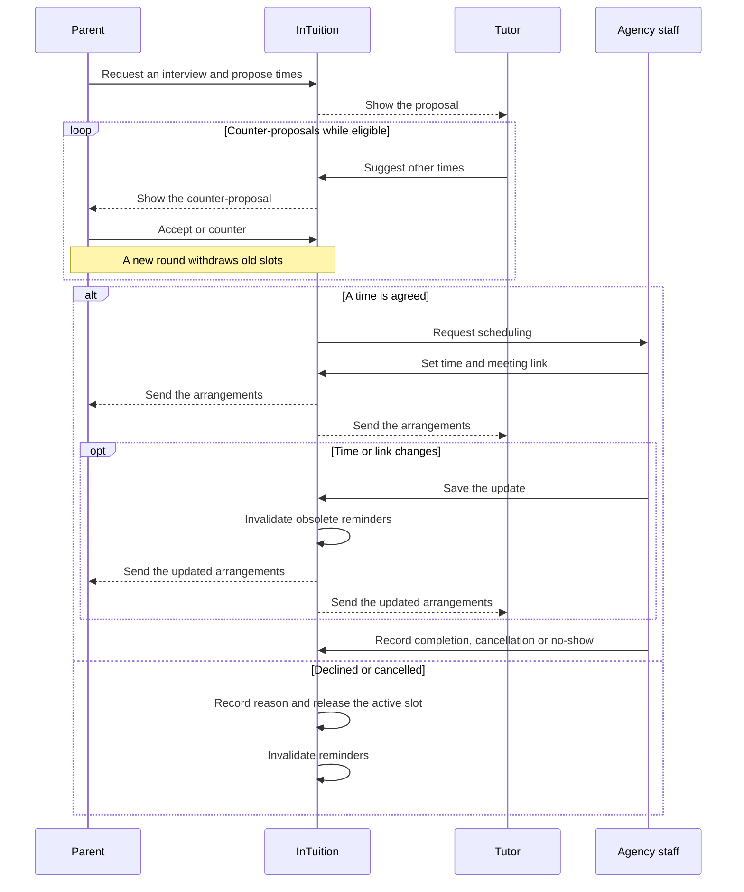
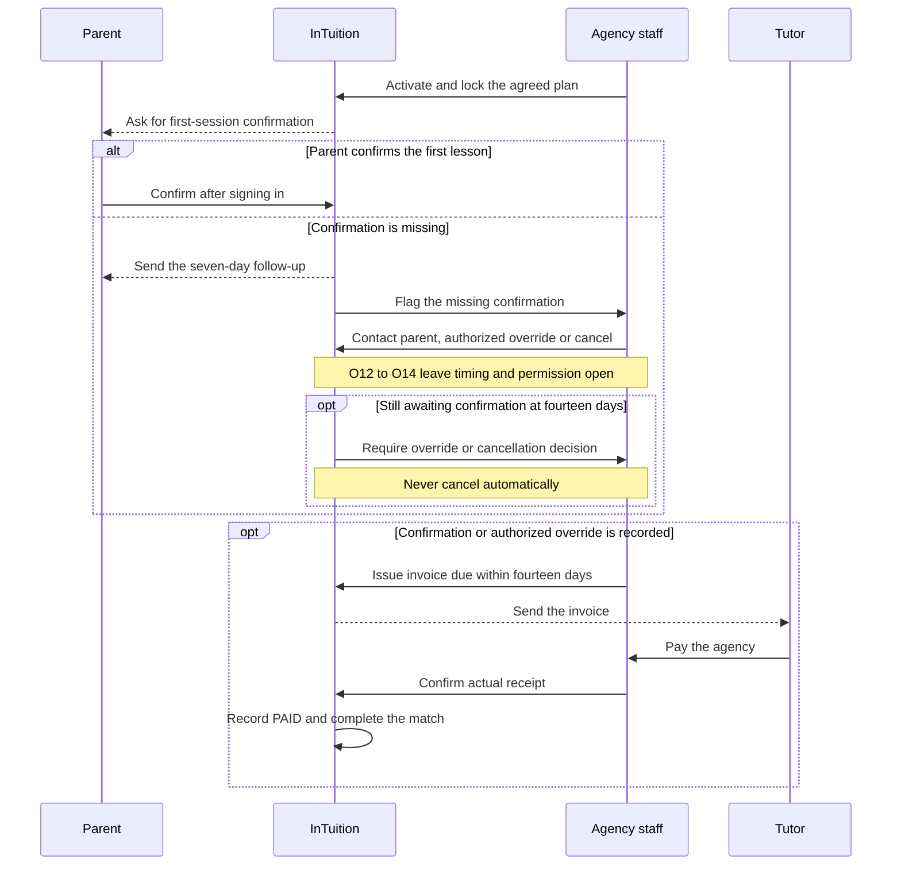
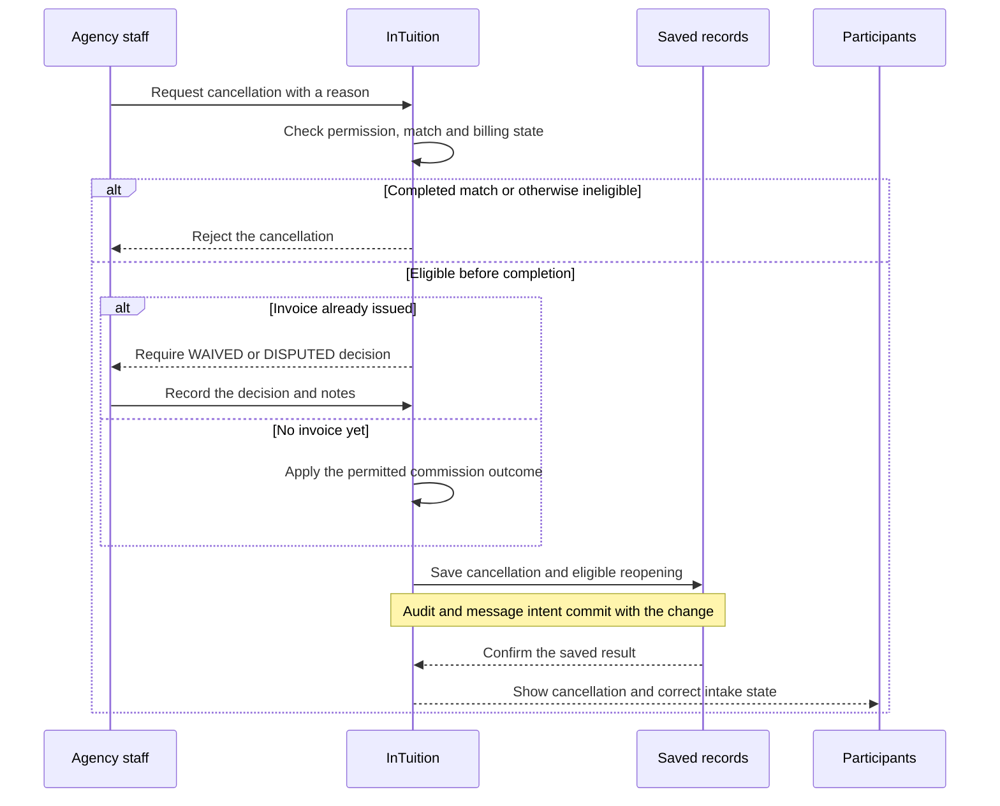
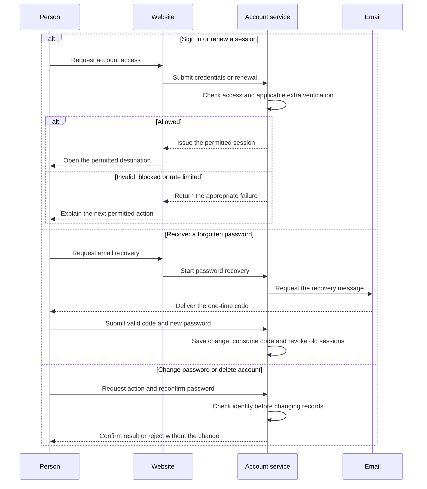
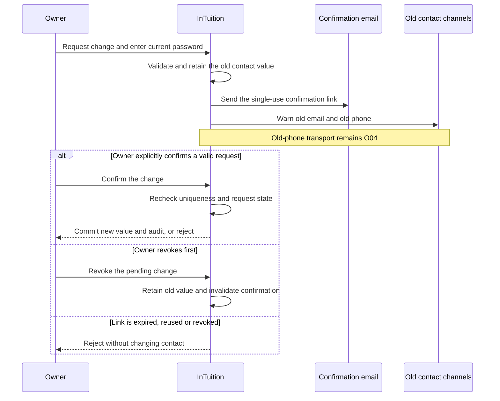
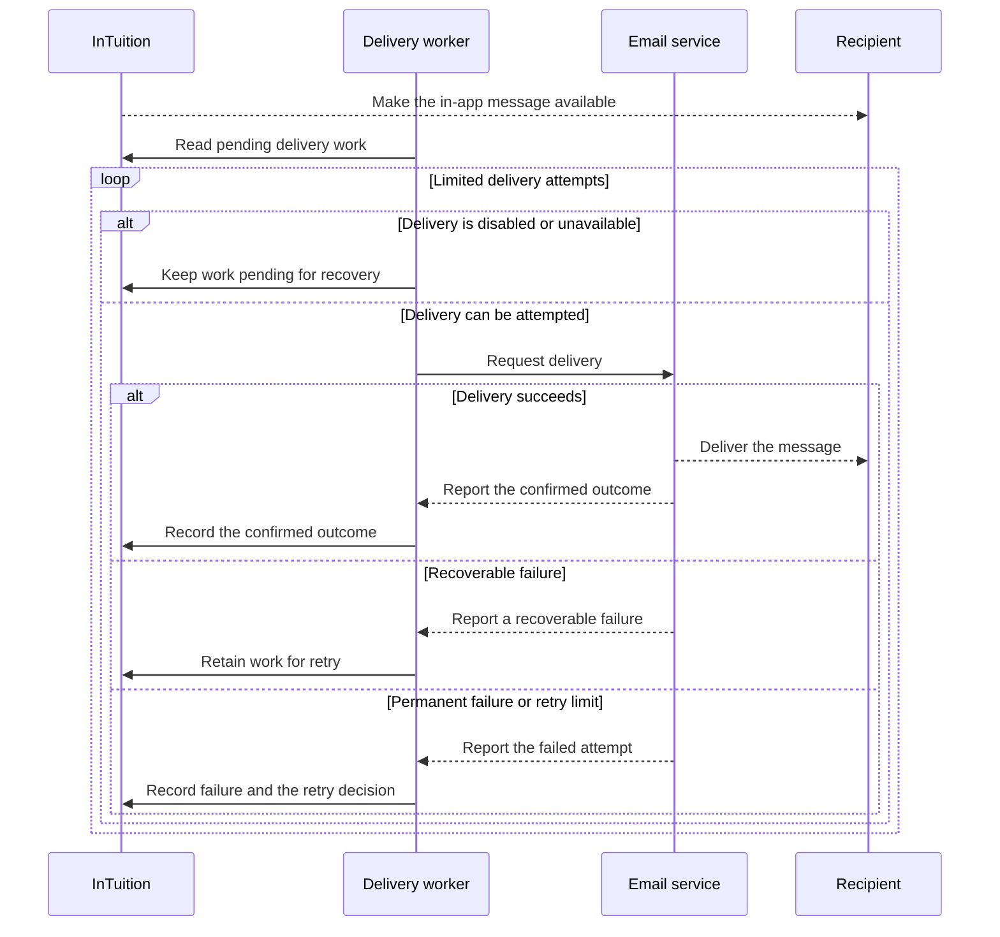

# Sequence diagrams and coverage

These diagrams show who acts, what happens next and where a request can stop. They summarize the **required product behaviour as of 18 October 2026**. InTuition is not live; a diagram is not a passing application test. The [current requirements](../specs/CURRENT-REQUIREMENTS.md) control, and the [current-file review](current-file-alignment.md) identifies implementation gaps.

Start with the [service overview](user-flows.md#service-overview) or the [browser, server and saved-result view](how-it-is-built.md#browser-server-and-saved-result). The six views below cover the handoffs that need more explanation. The separate [AI coding workflow](workflow-walkthrough.md) explains how the project is delivered; it is not a customer journey.

Each view has a prose explanation and detailed references for readers whose Markdown viewer cannot render Mermaid. On a narrow screen, use that prose and the linked numbered record if the diagram is too small to read. The coverage tables distinguish visual summaries from cases better explained in text. They account for documentation, not executed test coverage.

## Interviews

**Required journey; not a fresh run.** Covers UF10/UF15 and C07/C10/C11. Parent and tutor negotiate through InTuition. Agreement sends the interview to staff for scheduling; it does not assign a tutor or reveal personal contact.

The loop is optional: a tutor can accept the original proposal. A parent counter-proposal uses COUNTER_PROPOSED, and replaced slots become WITHDRAWN. A tutor's “cannot make it” response can continue negotiation; “not interested” ends it. An owner may cancel an eligible interview. The cap is three active interviews per post; terminal interviews cannot be edited. The retained negotiation inactivity rule is separate from unresolved post-expiry decision **O15**.

All visible times must mean Singapore time regardless of the computer's timezone. No-show outcomes include either person or both. New meeting links must reach both participants promptly; an old reminder must not send after rescheduling. **G04/G05/G09 remain open:** time input, BOTH-no-show recording, link-change notice/audit and reminder recovery are incomplete. The diagram's notification arrows are obligations, not evidence of delivery.

Details: [request](../specs/sequences/13-tutee-request-interview.md), [negotiation](../specs/sequences/42-interview-timeslot-negotiation.md), [scheduling](../specs/sequences/14-admin-schedule-interview.md), [meeting-link changes](../specs/sequences/15-admin-set-meeting-link.md), [outcomes](../specs/sequences/16-interview-completion-paths.md), [parent cancellation](../specs/sequences/35-tutee-cancel-interview.md), [scheduler safeguards](../specs/007-generic-scheduler-db-scheduler/requirements.md).

## Billing and agency receipt

**Required journey; substantially incomplete in the application.** Covers UF16, C02/C03/C17. Activation locks the first-month plan. The default fee is one commission, paid by the tutor to the agency, equal to 50% of the agreed first month's tuition fee. Parent-to-tutor lesson payment is separate.

The seven-day period has conflicting starts in the sources: activation, email sending or notification receipt. **O13** leaves that start and the related fourteen-day escalation timing unresolved. **O12** concerns detection versus delivery timing; **O14** concerns permission for an earlier staff override. The diagram does not select a clock or grant that permission. Silence proves neither a lesson nor payment.

After an authorized invoice, payment is due within 14 days. A receipt action requires confirmation and appropriate authority; it must be safe to repeat without duplicating the financial result. Recording agency receipt completes the match workflow, not the teaching relationship. An unpaid dispute won by the agency is still unpaid. **O10** retains advance/partial receipt, refund, early-termination and post-dispute questions; **O03** retains commercial defaults.

**G02 is still open:** activation and manual receipt recording exist, but the parent confirmation, follow-up, invoice and due stages are missing. The shorter implemented payment action cannot stand in for this full journey. Read [UF16](user-flows.md#uf16-first-session-invoice-commission-receipt-and-completion), [receipt rules](../specs/sequences/11-admin-mark-commission-paid.md), [the PRD billing journey](../specs/PRD.md) and [open decisions](../specs/CURRENT-REQUIREMENTS.md#open-decisions).

## Cancellation and financial records

**Required journey; historical implementation is not a fresh combined check.** Covers UF17 and C02/C03/C12. Cancellation must settle the match, related intake and the applicable debt decision without erasing collected money.

Before invoicing, apply the documented commission rule for that stage; the missing-confirmation cancellation path includes an explicit waiver. After invoicing, staff must explicitly choose WAIVED or DISPUTED and record notes. A dispute does not count as agency receipt. Reopen only eligible requests/applications and preserve why other intake was closed or expired. A completed match cannot be cancelled through this path, and PAID receipts are retained.

**O10 remains open** for refunds, reversals, early teaching termination and other unsettled financial cases. Current full cascade and race behaviour needs fresh evidence; **G08** also affects external messages. See [UF17](user-flows.md#uf17-cancel-a-match-and-reconcile-its-effects), [cancellation record](../specs/sequences/12-admin-match-cancel-cascade.md), [matching rules](../specs/modules/matching/spec.md) and [delivery recovery](#notifications-and-delivery-recovery).

## Account access and recovery

**Required alternatives, not one compulsory chain.** Covers UF03/UF04/UF06 and C09/C13. The person chooses the relevant path; registration and administrator creation have their own consent and authority rules in the coverage table.

Email delivery in this diagram is required, not guaranteed: an outage must leave recoverable delivery work pending. Password reset uses an emailed one-time code, unlike the contact-change confirmation link below. Invalid, expired or reused recovery credentials must not change the account. A valid reset lets the person sign in with the new password; it does not establish a new session merely by drawing a return arrow.

Parent/tutor access sessions last 30 minutes with the separate renewal rules. Server logout clears or invalidates protected sessions; page scripts cannot clear their protected cookies. A rate-limited renewal must leave both cookies unchanged. Wrong current passwords must not destroy the person's otherwise valid session. Account deletion is logical, revokes sessions across devices and retains required records; retention/anonymization timing remains **O08**.

**G10/G11 remain open:** one rate-limited renewal combination needs checking, and the website cannot complete the required MFA challenge. Admin access has environment-specific rules; the production requirement is not waived by a local example. **G08** affects recovery-email delivery. Details: [login](../specs/sequences/03-login-with-mfa.md), [session bootstrap](../specs/sequences/05-csrf-bootstrap.md), [rate limits](../specs/sequences/24-rate-limited-endpoint.md), [password recovery](../specs/sequences/04-forgot-reset-password.md), [password change](../specs/sequences/29-change-password.md), [account deletion](../specs/sequences/30-account-deletion.md).

## Contact changes

**Required journey with significant missing work.** Covers UF05 and C08. Confirm a new email through that new address; confirm a new phone through the already-verified account email. These destinations must not be interchanged.

Warnings are required at initiation, before the contact change commits, and include a separate protected revocation action. Confirmation and revocation compete on the same pending request; only the first valid transition can win. Opening a link alone does not change the account. A conflicting new value leaves the old contact intact.

**O04 is unresolved:** old-phone warning transport and inaccessible-channel recovery need decisions. The arrow to the old phone states the requirement, not an available delivery method. **G03 remains open:** templates, destinations, old-phone warning and owner revocation are incomplete. Read [012/REQ-004](../specs/012-tutor-apply-and-profile-ux/requirements.md#req-004--self-edit-phoneemail-via-an-email-link-confirmation-flow-with-anti-account-takeover-founder-override--2093), [UF05](user-flows.md#uf05-edit-a-profile-or-change-contact-details) and [the current-file review](current-file-alignment.md#g03--contact-changes-are-not-complete).

## Notifications and delivery recovery

**Required delivery boundary; current gaps remain.** Covers UF21 and C11/C12/C17. This starts after the [business change, in-app message and delivery intent are saved together](how-it-is-built.md#browser-server-and-saved-result). The in-app message and external email have separate outcomes.

An attempt stops when successful or moved to an explicit permanent/failed-message outcome; the loop does not resend completed work. A provider accepting work is not evidence that a person received or read it. Keep the provider's actual status rather than relabelling queue acceptance as delivery. Missing credentials, disabled transport or queue pressure cannot silently discard unfinished work. Recovery after restart must preserve the information needed to retry.

For interview reminders, also check the current schedule version and the per-recipient duplicate guard before sending. Rescheduling must invalidate obsolete work, including a job already running. **WhatsApp remains disabled** until its recorded conditions pass. Critical commission and scheduling messages have a five-minute target; other informational messages have a thirty-minute target. These are requirements, not measured results; **O12/O13** leave first-session follow-up timing unresolved.

**G08/G09 remain open:** disabled/missing-key delivery can currently appear complete, queue trimming can lose unfinished work, and reminder duplicate/outdated-job/recovery safeguards are incomplete. Current retry workers and a failed-message queue exist; the old “no consumer or failed queue” description is historical. **O15** also blocks post-expiry timing acceptance. See [notification centre](../specs/sequences/21-notification-bell-flow.md), [email delivery](../specs/sequences/26-email-fanout-on-event.md), [scheduler requirements](../specs/007-generic-scheduler-db-scheduler/requirements.md) and [current requirements](../specs/CURRENT-REQUIREMENTS.md).

## Coverage of the 21 user flows

“Text” is deliberate where a short permission, calculation or display rule explains more than another set of arrows. A diagram summarizes its stated part of a journey; linked text retains exceptions, open decisions and acceptance details.

| Flow | Visual summary or explicit text treatment |
|---|---|
| UF01 — discovery | [Service](user-flows.md#service-overview); [UF01](user-flows.md#uf01-browse-tutors-or-assignments) keeps guest bounds and public/detail distinctions in text. |
| UF02 — registration and consent | [Service](user-flows.md#service-overview) shows tutor fee acknowledgement; [UF02](user-flows.md#uf02-register-consent-and-complete-a-profile) keeps consent fields and optional profile capture in text because these are form rules. |
| UF03 — sessions | [Account access](#account-access-and-recovery). |
| UF04 — passwords | [Account access and recovery](#account-access-and-recovery). |
| UF05 — profile/contact edits | [Contact changes](#contact-changes); ordinary profile-field edits stay in [UF05](user-flows.md#uf05-edit-a-profile-or-change-contact-details) and the shared saved-result view. |
| UF06 — account deletion | [Account alternatives](#account-access-and-recovery); [UF06](user-flows.md#uf06-delete-an-account) retains deletion/retention limits. |
| UF07 — parent requests | [Service](user-flows.md#service-overview) shows submission/moderation; edit/close and keyboard cases remain [UF07 text](user-flows.md#uf07-create-edit-close-or-remove-a-tuition-request) because they are state/form rules. |
| UF08 — parent selection | [Service](user-flows.md#service-overview). |
| UF09 — invitations | [Service](user-flows.md#service-overview) shows eligible acceptance; [UF09](user-flows.md#uf09-invite-a-tutor-and-handle-the-response) retains withdrawal, cascading closure and O01. |
| UF10 — interview negotiation | [Interviews](#interviews). |
| UF11 — tutor profile/listing | [Service](user-flows.md#service-overview) shows the optional-listing boundary; field and consent controls remain [UF11 text](user-flows.md#uf11-maintain-a-teaching-profile-and-optional-listing). |
| UF12 — tutor applications | [Service](user-flows.md#service-overview); withdrawal eligibility remains [UF12 text](user-flows.md#uf12-apply-withdraw-or-respond-to-an-invitation). |
| UF13 — moderation | [Service](user-flows.md#service-overview), including rejection. |
| UF14 — assignment/activation | [Service](user-flows.md#service-overview); [billing](#billing-and-agency-receipt) continues from activation. |
| UF15 — interview operations | [Interviews](#interviews), including changed arrangements and terminal outcomes. |
| UF16 — billing/receipt | [Billing](#billing-and-agency-receipt). |
| UF17 — cancellation | [Cancellation](#cancellation-and-financial-records). |
| UF18 — analytics | [Text only](user-flows.md#uf18-inspect-financial-and-activity-analytics): metric populations, dates and unpaid-versus-received money need definitions, not another handoff. |
| UF19 — staff accounts | [Text only](user-flows.md#uf19-onboard-or-remove-an-administrator): creator/remover permissions and production setup are distinct from the shared [account access](#account-access-and-recovery) checks. |
| UF20 — matches/favourites/reviews | [Service](user-flows.md#service-overview) shows match/contact visibility. [UF20](user-flows.md#uf20-view-matches-favourites-and-reviews) keeps favourites, review eligibility and public display rules in text; these are small follow-up actions. |
| UF21 — notifications | [Delivery recovery](#notifications-and-delivery-recovery). |

## Coverage of the 43 detailed records

The numbered documents retain written contracts and historical descriptions. They do not each contain a rendered diagram. The mappings below identify the shared visual, or why a particular detail stays text-only. Historical filenames are retained so existing links continue working; current titles and rules take priority.

| Record | Visual or text-only treatment |
|---|---|
| [01 — parent registration](../specs/sequences/01-register-tutee.md) | Text: UF02 consent/account rules; protected storage follows the [saved-result view](how-it-is-built.md#browser-server-and-saved-result). |
| [02 — tutor registration](../specs/sequences/02-register-tutor.md) | [Service](user-flows.md#service-overview), with optional profile and required fee acknowledgement explained in text. |
| [03 — login and MFA](../specs/sequences/03-login-with-mfa.md) | [Account access](#account-access-and-recovery). |
| [04 — password recovery](../specs/sequences/04-forgot-reset-password.md) | [Account recovery](#account-access-and-recovery). |
| [05 — session bootstrap](../specs/sequences/05-csrf-bootstrap.md) | [Account access](#account-access-and-recovery); initial anonymous/session state and request protection stay text. |
| [06 — parent request creation](../specs/sequences/06-tutee-post-creation.md) | [Service](user-flows.md#service-overview). |
| [07 — optional tutor listing](../specs/sequences/07-tutor-post-creation.md) | Text: UF11 fields and optional-listing rule; it uses the shared [save/rejection boundary](how-it-is-built.md#browser-server-and-saved-result). |
| [08 — moderation](../specs/sequences/08-admin-approval.md) | [Service](user-flows.md#service-overview). |
| [09 — staff assignment](../specs/sequences/09-admin-match-creation.md) | [Service](user-flows.md#service-overview). |
| [10 — activation](../specs/sequences/10-admin-match-activation.md) | [Service](user-flows.md#service-overview) and [billing](#billing-and-agency-receipt). |
| [11 — agency receipt](../specs/sequences/11-admin-mark-commission-paid.md) | [Billing](#billing-and-agency-receipt). |
| [12 — cancellation and related records](../specs/sequences/12-admin-match-cancel-cascade.md) | [Cancellation](#cancellation-and-financial-records). |
| [13 — interview request](../specs/sequences/13-tutee-request-interview.md) | [Interviews](#interviews). |
| [14 — staff scheduling](../specs/sequences/14-admin-schedule-interview.md) | [Interviews](#interviews). |
| [15 — meeting-link update](../specs/sequences/15-admin-set-meeting-link.md) | [Interviews](#interviews). |
| [16 — interview outcomes](../specs/sequences/16-interview-completion-paths.md) | [Interviews](#interviews); BOTH-no-show and invalid terminal edits remain explicit text. |
| [17 — parent matches](../specs/sequences/17-tutee-views-matches.md) | [Service](user-flows.md#service-overview) shows permitted contact; dashboard display details remain text. |
| [18 — tutor matches](../specs/sequences/18-tutor-views-matches.md) | [Service](user-flows.md#service-overview) and [billing](#billing-and-agency-receipt). |
| [19 — submit a review](../specs/sequences/19-tutee-submits-review.md) | Text: UF20 eligibility and duplicate prevention; no separate multi-party handoff is needed. |
| [20 — protected tutor detail and public reviews](../specs/sequences/20-public-tutor-detail-reviews.md) | Text: UF01/UF20 distinguish public reviews from protected detail; the old anonymous-detail example is historical. |
| [21 — notification centre](../specs/sequences/21-notification-bell-flow.md) | [Delivery recovery](#notifications-and-delivery-recovery), with read/navigation controls retained in text. |
| [22 — favourites](../specs/sequences/22-favourite-toggle.md) | Text: UF20 and the record describe a small saved preference, not a new cross-role journey. |
| [23 — public browsing](../specs/sequences/23-public-browse-with-filters.md) | [Service](user-flows.md#service-overview); UF01 retains exact guest bounds. |
| [24 — rate limits](../specs/sequences/24-rate-limited-endpoint.md) | [Account access](#account-access-and-recovery); scope and trusted-proxy rules remain in the detailed contract. |
| [25 — protected writes](../specs/sequences/25-csrf-protected-write.md) | [Saved-result view](how-it-is-built.md#browser-server-and-saved-result). |
| [26 — email delivery](../specs/sequences/26-email-fanout-on-event.md) | [Delivery recovery](#notifications-and-delivery-recovery). |
| [27 — readable contact storage](../specs/sequences/27-encrypted-pii-write-and-lookup.md) | [Saved-result view](how-it-is-built.md#browser-server-and-saved-result) and its C13 note; the encrypted-storage filename is historical. |
| [28 — apply or withdraw](../specs/sequences/28-tutor-apply-withdraw.md) | [Service](user-flows.md#service-overview); withdrawal/reapplication rules remain text. |
| [29 — password change](../specs/sequences/29-change-password.md) | [Account alternatives](#account-access-and-recovery). |
| [30 — account deletion](../specs/sequences/30-account-deletion.md) | [Account alternatives](#account-access-and-recovery), with logical deletion and revocation explained nearby. |
| [31 — administrator creation/removal](../specs/sequences/31-admin-create-delete-admin.md) | Text: UF19 and the record define different creator/remover powers; the shared [account view](#account-access-and-recovery) does not replace them. |
| [32 — post edit/close](../specs/sequences/32-post-edit-and-close.md) | Text: UF07 distinguishes edit, close and logical removal; [save/rejection](how-it-is-built.md#browser-server-and-saved-result) is shared. |
| [33 — profile editing](../specs/sequences/33-profile-edit.md) | [Contact changes](#contact-changes) covers the separate protected contact path; ordinary profile fields remain text. |
| [34 — availability/showcase consent](../specs/sequences/34-tutor-availability-toggle.md) | Text: UF11 eligibility, revocation and cache timing are setting rules. |
| [35 — parent interview cancellation](../specs/sequences/35-tutee-cancel-interview.md) | [Interviews](#interviews), with ownership/non-terminal limits in text. |
| [36 — detail login gate](../specs/sequences/36-marketplace-detail-login-gated.md) | [Service](user-flows.md#service-overview) and [account access](#account-access-and-recovery). |
| [37 — assigned contact access](../specs/sequences/37-contact-reveal-post-assignment.md) | [Service](user-flows.md#service-overview) and its separate participant/state checks. |
| [38 — parent selection](../specs/sequences/38-choose-tutor-selection.md) | [Service](user-flows.md#service-overview). |
| [39 — staff applicant view](../specs/sequences/39-admin-applicant-view.md) | [Service](user-flows.md#service-overview) shows staff eligibility review; staff-only list access remains text. |
| [40 — public showcases](../specs/sequences/40-public-showcase-strips.md) | Text: UF01 and the record define limits on public summaries, consent and safe cache fallback. |
| [41 — staff analytics](../specs/sequences/41-admin-analytics.md) | Text: UF18 and the record define metric cohorts and date windows; another sequence would not explain the calculations. |
| [42 — time negotiation](../specs/sequences/42-interview-timeslot-negotiation.md) | [Interviews](#interviews). |
| [43 — tutor invitation](../specs/sequences/43-tutee-tutor-job-invitation.md) | [Service](user-flows.md#service-overview); UF09 retains O01 and cause-specific closure without inventing an invitation timeout. |

[User-flow guide](user-flows.md) · [Detailed sequence index](../specs/sequences/INDEX.md) · [AI coding workflow](workflow-walkthrough.md) · [Testing and release](testing-and-release.md)
