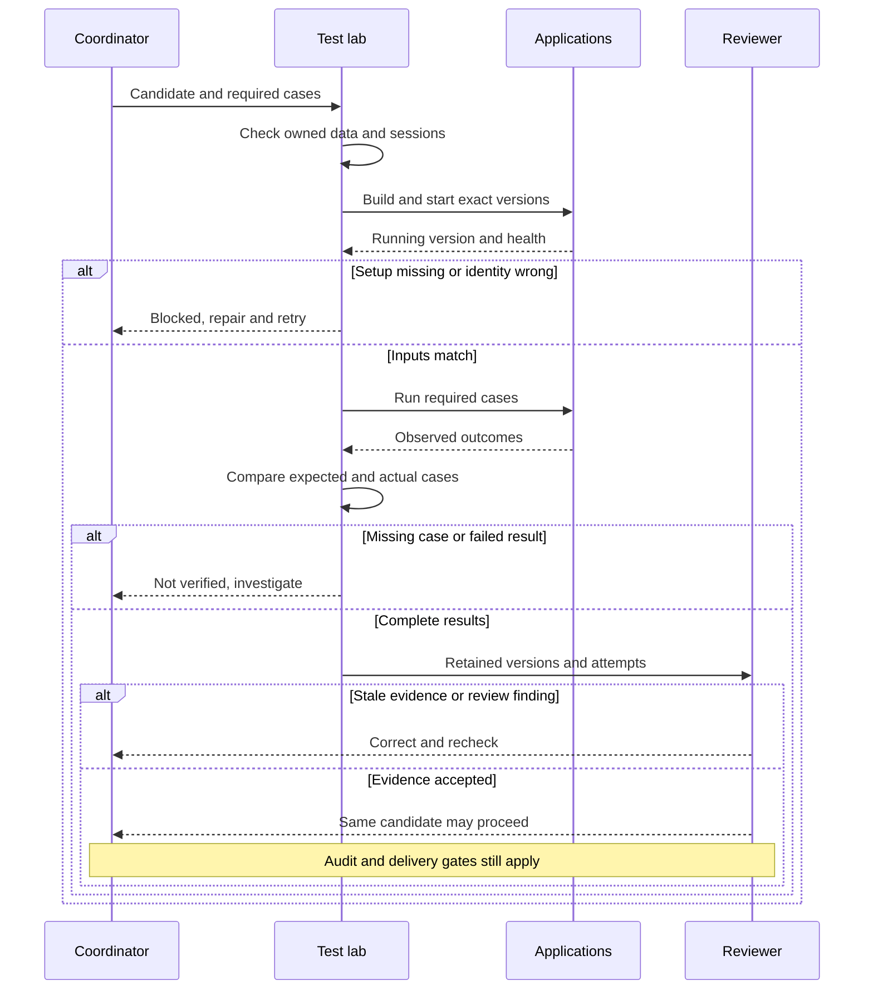

# Testing and release

InTuition is **not live**, and life commitments have delayed launch. This page describes the test inventory and automation found in the private repositories on 18 October 2026. Inventory counts below are files, not executed test cases. A later, limited baseline run is described separately.

## Intended test-lab handoff

**Target method, 18 October 2026.** This sequence combines standing evidence obligations with proposed lab controls. The inspected startup, result-reporting and protection gaps below remain open; these arrows do not report an installed gate or a successful current combined run. The [AI coding sequence](workflow-walkthrough.md#intended-ai-coding-workflow) supplies specification approval, review and the coordinator's final audit.

A candidate here means the exact set of application and test versions proposed for delivery. Required cases come from the approved task and the [user-flow requirements](user-flows.md), not from whichever tests happen to run. The paragraph after the diagram is a text alternative for narrow screens or readers without Mermaid support.

The coordinator supplies the approved scope, exact versions and full required-case list. The lab checks prerequisites and owned browser/session, fixture and build resources before startup. A missing or mismatched version blocks testing. After execution, every required case, browser and attempt must be accounted for: removed, filtered, skipped, aborted or unexplained retry-only cases cannot quietly pass. Retain successful and failed results; missing or expired evidence leaves the task unverified. Independent review returns findings to correction and fresh checks. Only the same unchanged candidate can proceed to the coordinator audit and development-delivery checks. Changing a relevant source, requirement, fixture or setting invalidates affected evidence.

A dirty-source snapshot may identify an investigative run. Delivery uses the clean reviewed committed candidate, with its build identity, observed local startup/affected flow and confirmed push. That handoff does not authorize production deployment. Keep browser sessions isolated or serialize shared access; confirm an old owner has stopped before reassigning files, sessions, fixtures or build resources. Reproduce potentially contaminated evidence in isolation before treating it as an application defect.

## Follow-up baseline check

On 18 October, a backend baseline completed with **2,179 tests in the main test phase and 43 integration tests**, with no failures, errors or skips in those phases. Formatting and the configured 97.5% line/branch coverage checks passed. The run used Java 21 and a Docker client compatibility setting; it did **not** include the separate live-system regression lab.

The frontend baseline stalled while reading installed dependencies, so no completed frontend gate is claimed. No application code was changed. These results do not close the documented feature gaps: a test can pass while asserting an older requirement, and this run did not prove the complete website journeys, delivery recovery or production readiness. Detailed logs stay private.

The backend result is identified as **BE-2026-10-18-A** in the private evidence index, which records the tested repository revision. Its tracked source was unchanged and clean for that baseline. This label identifies the limited run above; it is not an identity for the frontend, combined lab or a release candidate. No new application suite was run for the later six-role documentation review.

## What is present

| Layer | Tracked inventory | Purpose |
|---|---:|---|
| Backend test sources | 182 files: 125 named as tests and 57 as integration tests | Business rules, permission checks, controller behaviour, data access and running-system checks. |
| Backend regression lab | 49 of those 57 integration-test files | Exercises the running API from outside the application. This is a subset of the backend total, not an additional 49 files. |
| Frontend tests | 177 files | Components, forms, state and browser-facing behaviour in a simulated browser environment. |
| Playwright specifications | 57 files mixing browser interaction and direct API checks | Some exercise real screens; others send requests directly to the server and do not prove the corresponding website journey works. |

The backend uses JUnit, Mockito and Testcontainers. Testcontainers starts real services for selected integration tests, allowing database behaviour to be checked rather than replaced with a mock. The frontend uses Vitest 4.1.7 and React Testing Library. The separate browser-test lockfile resolves Playwright 1.60.0.

The inventory was counted from tracked filenames in each repository, without executing the tests. Parameterised tests, generated cases, skipped tests and browser variants can change an execution count, so file totals should not be presented as a number of passing tests.

The later independent review reproduced these file counts. It also checked what the tests actually do: the central matching scenario opens the landing page, then performs its business steps through direct server requests. Its contact check uses an assigned PENDING match, while the website requires ACTIVE or COMPLETED. That test cannot prove the matching screens, the website's narrower contact rule, or the missing first-session billing journey. The request-form case study below does operate the browser form. [Playwright explains this distinction between API requests and page interaction](https://playwright.dev/docs/api-testing).

Some test expectations also preserve behaviour that conflicts with newer requirements: guest filters stay hidden, and interview input uses the computer's local timezone. Passing those tests would not establish compliance. The [current-file alignment review](current-file-alignment.md) records the affected requirements and the checks still needed.

## The checks configured in CI

Continuous integration, or CI, runs automated checks when code changes are submitted. GitHub Actions supports checks on pushes and pull requests and makes their results available during review. [GitHub's CI documentation](https://docs.github.com/en/actions/get-started/continuous-integration).

| Workflow found | Configured checks | Important boundary |
|---|---|---|
| Backend | Java build, formatting check, unit and selected integration tests, then coverage thresholds of 97.5% for both lines and branches. | The running-system regression lab is explicitly excluded from this separate-repository workflow. It belongs in the combined workflow. |
| Frontend | Lint, TypeScript/build checks, tests and coverage thresholds of 97.5% for lines and 88% for branches. | Two cross-repository taxonomy checks depend on the backend checkout being available. They can skip when that prerequisite is absent. |
| Combined application | Contains steps intended to start the applications and supporting services, check health and build identity, then run short browser and server checks on pull requests in the test repository, with broader runs on other triggers. | Source review found incompatible build paths and a version request to a protected endpoint. The current setup cannot be relied on to reach those tests. It also selects moving application development branches, not the exact changes being approved. No current successful combined run was established. |

Coverage measures which instrumented lines and decision branches ran during tests. It does not measure whether requirements are complete, assertions are useful, or the interface works for a person. Both coverage configurations exclude some files or categories, so these thresholds are not percentages of every file in the application.

The combined workflow records selected versions and attempts to compare the running backend's identity with the expected build. The application checkouts are beside the test checkout, but the build configuration expects them inside it. Its anonymous version request also targets an administrator-only endpoint, although a separate public version endpoint exists. These are source-based blockers, not newly observed runtime failures. Repair and demonstrate startup and version checking before relying on the workflow. Detailed administrator status must remain protected.

Failure evidence is also limited: combined-workflow artifacts expire after seven days; the separate application workflows upload results only on failure, and the backend upload omits its integration-test reports. Browser traces, video and screenshots are configured for failures, but a board link may later point to an expired artifact. The plan requires retained success and failure summaries before task completion.

## Limits that remain visible

- **Browser coverage is not established by configuration alone.** The Playwright configuration declares desktop Chromium, WebKit and a mobile-sized Chromium project. The inspected CI setup installs Chromium only. A complete successful run of the declared browser matrix should not be inferred from those files.
- **Some safeguards are conditional.** The frontend taxonomy checks can skip without the sibling repository. A comparison between combined-test settings and local settings also skips when its comparison baseline is unavailable.
- **Earlier contract-testing plans exceed the inspected implementation.** Older strategy documents propose Pact and a contract broker. The inspected dependency manifests and CI workflows do not establish those tools as implemented gates. The browser repository does contain API inventory and contract-comparison utilities; these are a different approach and are not proof of a Pact setup.
- **Old versions and labels need context.** Earlier draft documents mention other React or PostgreSQL versions. Historical “shipped” or “deployed” labels describe development work and must not be read as a current public launch announcement.
- **Later requirement corrections need implementation as well as evidence.** The request form lacks the corrected control-specific Enter and input-composition guards. Its existing browser tests cover only part of the keyboard contract. Some no-show tests also require optional database access that the combined workflow does not enable; they do not establish coverage for both participants missing an interview.
- **Message failure handling needs correction and tests.** The technical review found paths that can treat disabled email delivery or a missing provider key as success. It also found a queue size limit that does not first protect all unread or unfinished work. The current requirements call for pending messages to remain available until delivered or explicitly recorded as permanent failures. Those paths need correction and failure-and-recovery tests before launch.
- **Test-report utilities can overstate what ran.** The endpoint utility treats a report's overall success flag as a passed case. In the installed Playwright version, that flag can include skipped cases and cases that passed only after retries. It then credits file-level references and shared helpers. The route report counts static routes from the presence of a smoke-test file. These percentages do not prove that each action or page passed; required cases need results for each browser and attempt. [Playwright's result definition](https://github.com/microsoft/playwright/blob/v1.60.0/packages/playwright/src/common/test.ts#L275).
- **A script is not automatically a required check.** The combined workflow does not invoke the lab's lint, endpoint-coverage gate, live inventory comparison or contract comparison. A written policy for temporarily excluding unreliable tests also has no enforced expiry in the inspected configuration. These are process gaps to track, not completed safeguards.
- **Wiring in the existing utilities would not be enough.** The inventory comparison prints missing and stale entries without returning failure. The contract comparison checks endpoint names and shallow field types but misses changes such as allowed values, nested references and response details. Each proposed blocking check needs a deliberate failure example and evidence from the application that uses the interface.
- **Test data and targets need stronger controls.** Some browser tests share seeded accounts and server-side limits. The optional reset process is not shown to refuse an unintended environment, and browser and API destinations are configured separately. The existing smoke suite includes writes, so it is not established as a read-only check suitable for a customer environment. The improvement plan calls for isolated test data, verified destinations and a separate, reviewed read-only check.

Read-only GitHub checks on 18 October found neither classic branch protection nor active branch rules on the two application development branches. The lab's main branch has protection, but no required status checks, zero required approving reviews and no administrator enforcement. Both application repositories returned an empty deployment-environment list. A workflow naming a production environment does not establish an approval gate. These are scoped observations, not an audit of every account control; no settings were changed. [GitHub environment rules](https://docs.github.com/en/actions/how-tos/deploy/configure-and-manage-deployments/manage-environments).

These limits are retained to make the specification useful to a reviewer. Read the [current requirements](../specs/CURRENT-REQUIREMENTS.md), [development workflow history](../specs/domain/dev-workflow.md) and [historical test strategy](../specs/domain/backend/test-strategy.md) with their status notes.

The [project workflow improvement plan](workflow-improvement-plan.md) explains how the regression lab should be maintained as part of development: who owns its fixtures and failures, how AI updates tests against approved rules, which versions must run together and what evidence is needed before closing an issue.

## Why more than one kind of test matters

A component test can check form validation quickly. A database test can check that competing writes preserve a rule. A browser test can show whether someone can actually complete a journey. Review can expose a requirement that none of those tests currently covers.

The [request-form case study](how-i-work.md#example-a-review-step-that-submitted-too-early) shows this distinction: a real browser exposed a submission bug that the simulated environment did not reproduce. Playwright's guidance also emphasises visible user behaviour and isolation between tests; these are useful principles for assessing tests rather than relying only on their quantity. [Playwright best practices](https://playwright.dev/docs/best-practices).

When a check fails, the intended loop is to reproduce it, determine whether the cause is implementation, test setup or a requirement mismatch, correct it, and repeat the affected checks. A retry that happens to pass is not by itself an explanation. A review finding returns to the same loop and remains open until its evidence is checked.

## Before a public launch

Manual release workflows and an [infrastructure deployment specification](../specs/027-aws-production-deployment/spec.md) are present. They describe a release process; they do not demonstrate that hosting prerequisites, approvals or operational checks are in place. The release workflows also treat green CI as a prerequisite rather than rerunning every check themselves.

The inspected deployment workflows do not enforce successful CI for the exact selected version. Backend database changes occur before its trial deployment; stopping that deployment does not reverse those database changes. The specification requires compatibility with the previous application and a database-change check, whose enforcement was not established. The frontend deployment workflow has no subsequent running-version or smoke check. A future rehearsal must demonstrate approval, exact-version checks, compatible database changes, post-deployment behaviour and recovery. The founder must choose an approval mechanism supported by the available GitHub plan.

A future launch needs current evidence for the chosen application versions: the relevant automated checks, the critical user journeys, pending requirement corrections and the operating checks in the deployment plan. Features that remain switched off need their own enablement evidence. Nothing on this page reports a fresh release, uptime measurement or customer-facing availability.

## Evidence behind this page

The private files inspected were the backend Maven build and CI workflow, frontend package files, test configuration and CI workflow, and the browser-test package files, configuration and combined workflow. Tracked test filenames supplied the counts. No private source, executable test code, workflow configuration, raw logs or service identifiers are included in this public copy.
