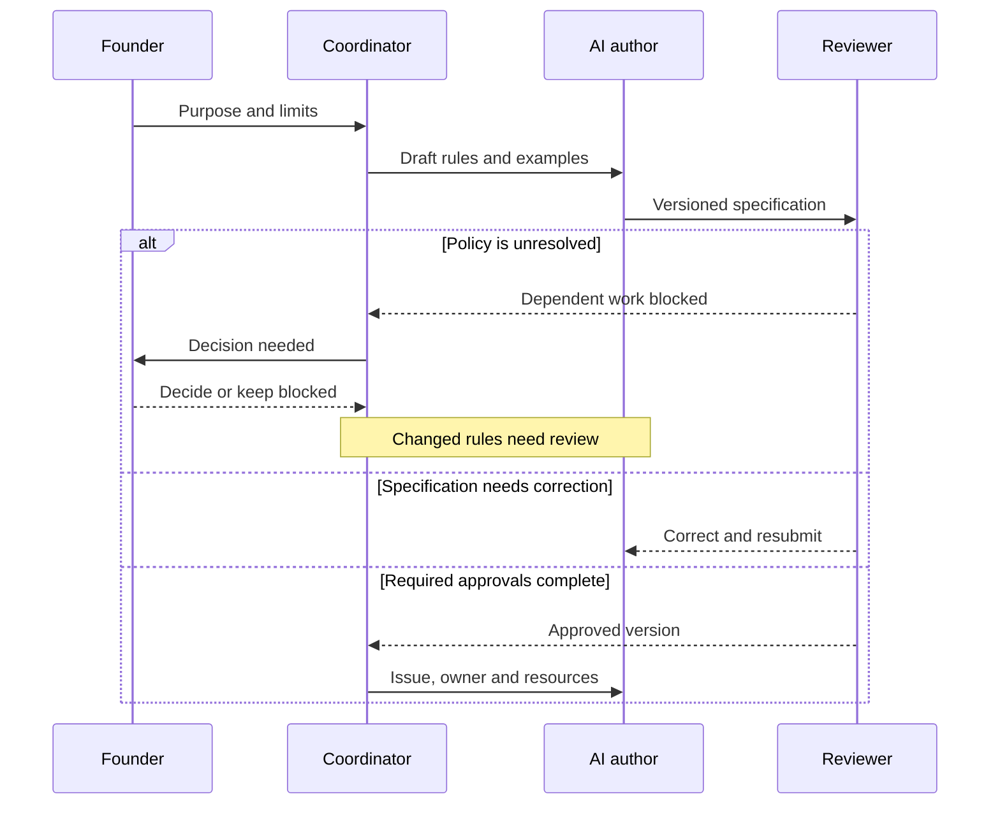
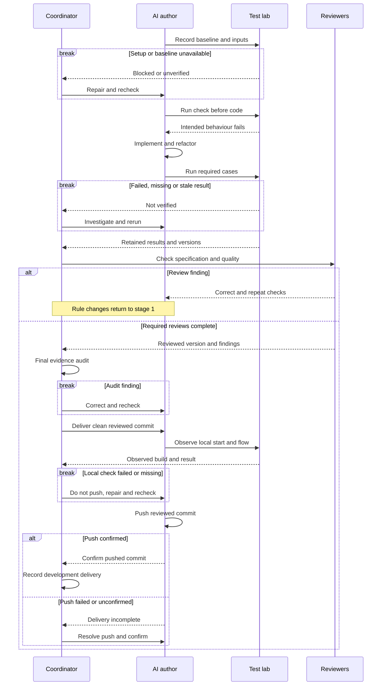

# From a request to a checked change

This is the intended project delivery loop: how AI work is organised through specifications, assigned tasks, tests and review. It summarizes written obligations, not proof that every historical task followed them. The roles are responsibilities in an AI-assisted project, not employees. InTuition remains unlaunched.

**Status, 18 October 2026:** W01's conflicting historical review instructions remain unresolved. This page does not waive standing full review or the coordinator's final evidence audit. Proposed automation in the [improvement plan](../improvement-plans/ai-workflow.md) is not established as installed. Product journeys are separate in [User flows](user-flows.md).

## Intended AI coding workflow

The two stages form one sequence. Only an approved specification enters stage two. The prose below is also a reading alternative when a diagram is too small or cannot render. See the [test-lab handoff](testing-and-release.md#intended-test-lab-handoff) for the detailed checks between a test result and delivery.

### Stage 1: agree on the change

The founder decides business policy and priorities. AI prepares the rules; reviewers other than the author challenge them. A policy answer or corrected draft returns through specification review. Silence, an AI vote or an existing implementation does not approve a decision.

### Stage 2: build, check and deliver in development

A new feature and a defect fix both need a check that fails for the intended missing behaviour before production code changes. An import, setup or identity failure is not that result; repair it and repeat the check. A defect also needs a supported explanation of its cause. The documentation-only exception uses document checks rather than an artificial application test failure.

The coordinator audits the actual evidence after all required reviews. Development delivery then needs the clean reviewed committed source, its identified build, direct observation of local startup and the affected flow, retained results and confirmation that the intended commit was pushed. Failed or missing local checks stop the push. A failed or unconfirmed push keeps delivery open. Production deployment and admission of trial users require separate founder decisions and additional checks described below.

## 1. Start with the need

Record who is affected, the expected outcome and the founder's limits on scope and effort. Business and product review identify unanswered questions. Resolve a policy question before dependent implementation; unrelated investigation can continue. The [current register](../specs/CURRENT-REQUIREMENTS.md) retains the open decisions.

## 2. Write down the rules

Prepare the requirement, design, task and pass/fail examples. Include permissions, failure cases and affected journeys. Keep stable requirement IDs and the exact version. Where documents disagree, name the controlling decision or record the conflict; do not choose policy through code.

## 3. Review the specification before building

Independent counterpart reviewers and the required final authority approve the corrected specification before implementation. The author cannot approve it. Material changes return to this step, including changes discovered during implementation or result review. Old sign-offs do not approve a new version.

## 4. Make the issue small enough to check

Assign the approved issue, file scope, dependencies, acceptance cases and evidence needed. Name owners for the browser/session, test data and build output as well as files. Shared browsers and cookie stores need serialized access or separately verified isolated contexts. Coordinate fixtures and stack changes; serialize shared build output and repository gates.

For example, a form task can assign one AI author its files and build, and give a separate reviewer an isolated parent browser context with its own synthetic records. If isolation is unavailable, schedule those runs one at a time. Suspected session contamination makes the evidence suspect until reproduced in isolation.

Before transferring work, confirm the previous owner has stopped. Save the source/specification version, current changes, completed commands, running work, evidence, blocker and exact next action. The next writer accepts those files and runtime resources explicitly.

## 5. Use AI to implement the change

Record the starting revisions and available baseline results before editing. Diagnose missing or failed prerequisites and block affected work as needed; never call an unavailable baseline green or reset unrelated shared data to obtain a pass.

For a feature, derive a check from the approved rule, observe the intended failure, implement the behaviour, rerun and refactor while passing. For a bug, first reproduce it and establish the cause, then follow that same failing-check cycle. Pure documentation, logic-free markup/configuration and throwaway exploration retain their existing test-first exceptions; this prose edit needs no application suite.

A new field rule should initially fail because the required result is absent. The request-form bug should initially show an unintended request when entering Review. A failed service startup demonstrates neither. Changes to a shared interface also need its consumers to check compatibility before their dependent work is released.

## 6. Run the relevant tests

Use the required layers: browser actions, API rules, persistence and delivery are different observations. Identify the frontend, backend, tests, migrations, fixtures and settings used. Reconcile the complete expected case list with actual results for each required browser and attempt.

A removed, filtered, skipped or aborted required case leaves acceptance incomplete even if everything else passes. Preserve first failures and retry outcomes. Missing/stale evidence or an unexplained retry-only result cannot become verified. Classify the cause as product, setup or requirement, correct it and rerun affected checks. The [lab sequence](testing-and-release.md#intended-test-lab-handoff) shows this gate.

## 7. Review the result and its evidence

Reviewers separate from the author first check specification compliance, then quality and effects on related journeys. They open the exact change and results. Retain the standing full review and coordinator audit while W01 remains open; the proposed smaller review is not adopted here.

Findings return to correction, affected tests and independent recheck. Changed requirements return to specification approval. After the required reviewers report, the coordinator checks evidence, unresolved findings and omitted obligations. Reviewer approval alone does not mark the task done.

## 8. Update the records together

Keep the requirement, design, issue, tests, decision and evidence links aligned. Name the reviewed version and date older evidence. A private snapshot of uncommitted work can identify an investigation; it does not authorize deploying mixed uncommitted changes. Development delivery uses the clean reviewed committed version and observed local result described in stage two.

## 9. Decide whether it is ready to release

The founder decides production release using current journey, permission, migration, delivery and recovery evidence for the same reviewed version. Confirm the deployed version and required post-deployment checks. Trial admission also needs operating capacity and business decisions. A verified development run or confirmed push does not establish any of those outcomes. See [production obligations](testing-and-release.md#before-a-public-launch).

## What the loop looks like in practice

The request-form record shows a narrow historical button fix and a later keyboard requirement that remains incomplete. [Read its dated evidence and limits](how-i-work.md#example-a-review-step-that-submitted-too-early). The separate [documentation delivery](how-i-work.md#example-a-completed-documentation-delivery) demonstrates source comparison, corrections and publication checks without an application run.

This coding workflow applies to work across the [21 user flows](user-flows.md) and [43 detailed sequence records](../specs/sequences/INDEX.md). That is navigation and process coverage, not proof that all acceptance cases ran. Diagram rendering checks this document, not the application.

[Back to the README](../README.md) · [Testing and release](testing-and-release.md) · [Current decisions](../specs/CURRENT-REQUIREMENTS.md)
