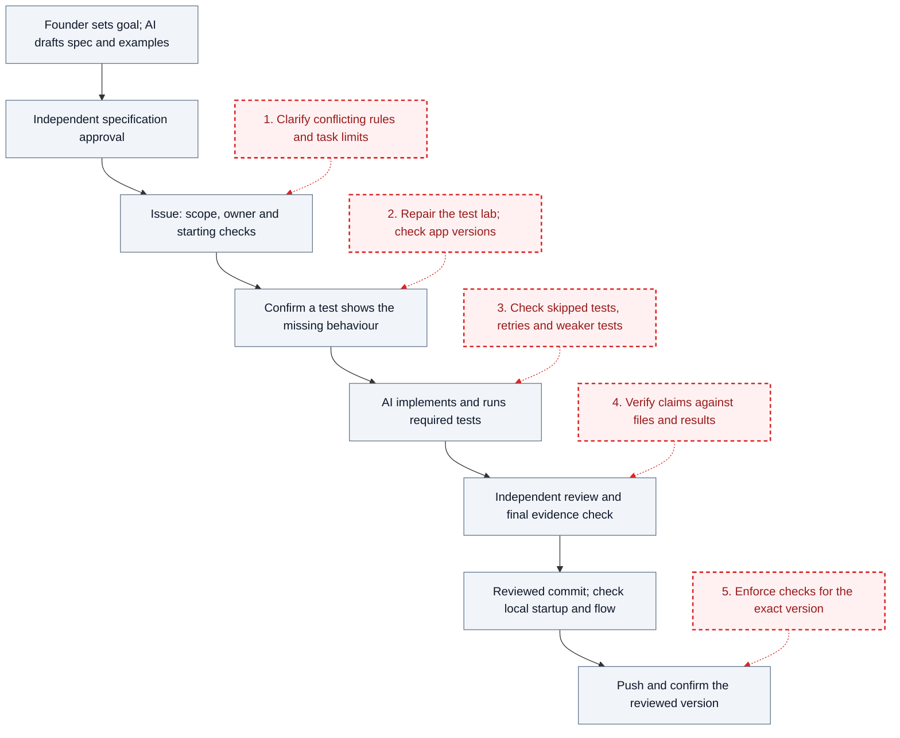

# Improvement plans

This directory collects proposals for improving how AI is used to build InTuition. The [detailed AI workflow plan](ai-workflow.md) contains the reasoning, owners and checks. The [testing guide](../docs/testing-and-release.md) and [current gaps](../docs/current-file-alignment.md) describe the supporting evidence.

**InTuition is not live.** The improvements are proposed; adding these plans does not implement them or make the application ready to launch. A successful current run of the combined test lab has not yet been verified.

## Current written workflow and proposed improvements

Neutral boxes show the written workflow. Red dashed boxes show proposals numbered in the table below. The diagram does not show that every past task followed this process.

Specification approval precedes implementation. Record the baseline and versions; observe a test fail for the intended missing behaviour before changing production code. A defect also needs a supported cause. Documentation uses document checks.

Failures return to correction, affected tests and independent recheck; changed rules return to specification approval. Standing full review and the coordinator's final evidence audit remain required while workflow conflicts remain unresolved. Delivery needs a clean reviewed commit and observed local startup and affected flow. Failed or missing local checks stop the push; an unconfirmed push leaves delivery incomplete. Development delivery does not authorize launch. See the [full sequence and correction loops](../docs/workflow-walkthrough.md#intended-ai-coding-workflow).

## Five improvements and how to check them

| Proposal | Action | Evidence needed to pass |
|---|---|---|
| 1. Clear rules and task limits | Resolve conflicts; record the approved rule, scope, owner and dependencies. | One applicable procedure is identifiable; unresolved decisions block dependent work. |
| 2. Dependable test lab | Repair startup and check running versions. | A clean build runs tests. Correct versions pass; wrong or missing versions stop it. Protected status stays protected. |
| 3. Trustworthy tests and results | Account for required cases, browsers and attempts; review test changes. | Missing or skipped cases leave acceptance incomplete. Retries remain visible; weaker tests need replacement evidence or an approved rule change. |
| 4. Review grounded in evidence | A separate reviewer opens rules, changes and results. | Findings cite sources; corrections receive independent rechecks before the coordinator's audit. |
| 5. Checks tied to the exact version | Retain versioned evidence and prove proposed required checks. | Known-bad examples fail and are blocked by required checks. Missing or stale evidence cannot authorize delivery. |

The [detailed plan](ai-workflow.md#maintain-the-lab-with-each-change) explains these checks and proposed enforcement. This table grants no approval.

## Start with one repair, then one small product fix

First, prepare one lab repair: correct build paths and the version probe, then demonstrate startup and passing and failing version checks. Agree its specification, founder time and spend limit before implementation. Billing remains blocked planning work while policy decisions are unresolved.

After independent review of the repair, select one small product fix for a later cycle. Guest search is a candidate, not an approved task. Define its user outcome and follow the same failing-test, implementation and review loop. Choose from the observed bottleneck; see [the first cycle](ai-workflow.md#first-cycle-and-feedback).

After a fix is completed and verified, publish a short Markdown case study: the requirement, AI assignments, human decisions, mistake found, correction and dated verification. Keep application code, secrets and raw operational records private. This is a proposed future case study, not a claim that the pilot has run.

## Keep handovers and effort visible

Assign one writer per shared area and owners for sessions, test data and build output. Isolate parallel work or use shared resources one at a time. Stop the previous owner before reassignment. Save versions, files, changes, commands, results, running work, blocker and next action so another owner can resume. See [ownership and handover](ai-workflow.md#bound-ai-work-and-inspect-progress).

Compare estimated and actual founder time, elapsed time, review rounds, blocker time and AI/tool cost. Record skips, retries and reopened defects. Mark missing measurements and use observed results to adjust task size and work order.

[Back to the project](../README.md) · [Detailed AI workflow plan](ai-workflow.md)
